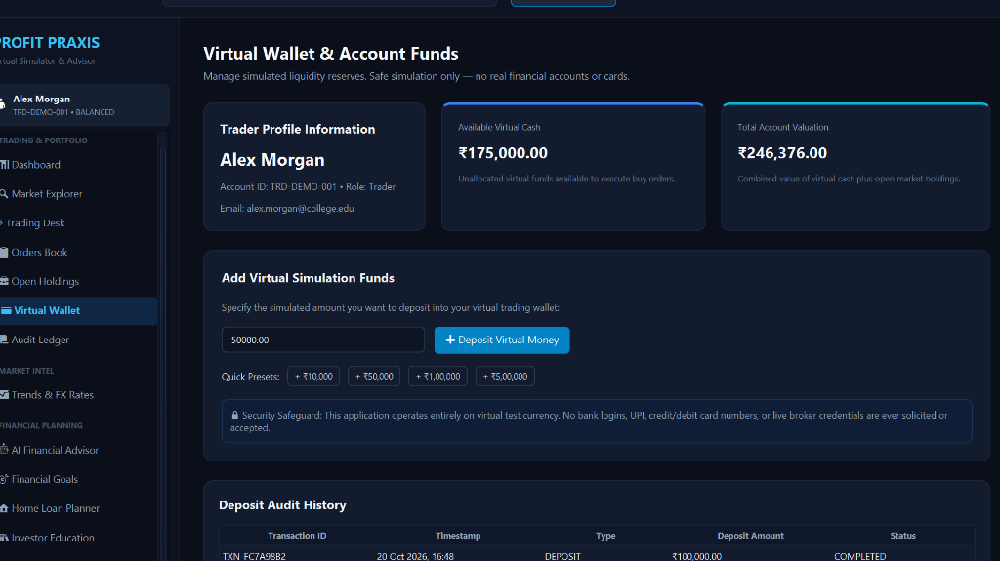

# InvestIQ: Stock Trading & Portfolio Management System
> **An Investment Simulator with an Educational Financial Advisor**  
> *Second-Year B.Tech Information Technology — Object-Oriented Programming (OOP) Mini-Project*

---

## 📸 Desktop Application UI Showcase

Here is a live look at the modern fintech interface of **InvestIQ**:



---

## 📌 1. Project Overview & Objective

The **Stock Trading & Portfolio Management System (InvestIQ)** is a complete, professional desktop application developed in **Java 21** using **JavaFX**, **SQLite (JDBC)**, and **Maven**. It provides an authentic financial simulation environment where users can learn how financial markets operate, practice active stock trading and portfolio management, understand risk diversification, and receive rule-based educational advisory insights.

### Core Objectives
1. **Zero Financial Risk:** Operates strictly in an educational simulation environment (starts with ₹1,00,000.00 initial balance). No real bank credentials, brokerage accounts, or real money are ever used.
2. **Pedagogical Integrity:** Designed from the ground up to demonstrate every foundational Object-Oriented Programming (OOP) concept with clean architectural separation.
3. **Institutional Precision:** All monetary amounts, transaction fees, and calculations use `java.math.BigDecimal` with `HALF_UP` rounding to prevent binary floating-point inaccuracies.
4. **Holistic Wealth Planning:** Combines active multi-asset trading (Stocks, ETFs, Sovereign Bonds) with systematic wealth-building tools (SIP calculator, compounding lumpsum, currency exchange), interactive salary budgeting, loans (loan against stocks/mutual funds, home mortgages, personal loan debt affordability), and milestone goal planning.
5. **Real-Time Multithreading:** Features a background market ticker thread updating simulated quotes with Brownian drift at fixed intervals and asynchronous worker threads for non-blocking file handling.

---

## 🛠️ 2. Technology Stack & Prerequisites

| Layer | Technology | Details |
| :--- | :--- | :--- |
| **Language** | Java 21 (LTS) | Modern Java records, pattern matching, switch expressions, streams |
| **GUI Framework** | JavaFX 21 (OpenJFX) | JavaFX Controls, Charts (LineChart, PieChart), CSS-based modern dark theme |
| **Build Tool** | Apache Maven 3.9+ | Automated dependency resolution and lifecycle management |
| **Database** | SQLite 3 via JDBC | Local transactional persistence with ACID compliance (`stocktrading.db`) |
| **Testing** | JUnit 5 (Jupiter) | 46 unit tests validating core math, trading rules, and persistence |
| **IDE** | IntelliJ IDEA | Fully configured and ready to open as an existing Maven project |

---

## 🏗️ 3. Software Architecture & Design Patterns

The codebase is structured under `com.stockportfolio` into distinct decoupled packages:

```
com.stockportfolio
├── database/        # Database initialization, SQLite connection management, and data seeder
├── exception/       # Custom business exception hierarchy (Checked & Unchecked)
├── model/           # Core domain entities, enums, records, and polymorphic hierarchies
├── provider/        # Market data provider abstraction and simulated exchange rates
├── repository/      # Data Access Objects (DAO) implementing JDBC CRUD queries
├── service/         # Business logic layer (Trading, Portfolio, Advisor, Loans, Goals, Multithreading)
├── ui/              # JavaFX views, event dispatcher (UIContext), and components
└── util/            # High-precision financial math (MoneyUtil, FeeCalculator, HomeLoanCalculator)
```

### Applied Design Patterns
- **Repository Pattern:** Separates database access code (`AssetRepository`, `TransactionRepository`, `TraderRepository`, `FinancialGoalRepository`) from business logic.
- **Strategy / Provider Pattern:** `MarketDataProvider` interface allows seamless swapping between `MockMarketDataProvider` and real live REST API market providers.
- **Observer Pattern:** `UIContext` maintains dynamic data listeners (`notifyDataChanged()`) so that any trade, price refresh, or deposit automatically updates dashboard counters, tables, and charts across all views.
- **Model-View-Controller (MVC) Separation:** JavaFX views handle presentation and user input, delegating all validation and calculations to the service layer.

---

## 🎓 4. OOP Concepts Mapping (Viva Reference)

| OOP Principle | Implementation in Code | Method / Class Reference |
| :--- | :--- | :--- |
| **Encapsulation** | Private fields, validation invariants, immutable collections, `BigDecimal` scale control. | [`Position`](src/main/java/com/stockportfolio/model/Position.java), [`Trader`](src/main/java/com/stockportfolio/model/Trader.java), [`FinancialProfile`](src/main/java/com/stockportfolio/model/FinancialProfile.java) |
| **Inheritance** | Base asset hierarchy (`Stock`, `ETF`, `Bond` extending `Asset`) and order hierarchy (`BuyOrder`, `SellOrder` extending `Order`). | [`Asset.java`](src/main/java/com/stockportfolio/model/Asset.java), [`Order.java`](src/main/java/com/stockportfolio/model/Order.java) |
| **Abstraction** | Interfaces decoupling data sources and contracts from concrete implementations. | [`MarketDataProvider`](src/main/java/com/stockportfolio/provider/MarketDataProvider.java), [`ExchangeRateProvider`](src/main/java/com/stockportfolio/provider/ExchangeRateProvider.java) |
| **Polymorphism** | Dynamic dispatch of abstract methods (`getDetails()`, `execute()`, `canExecuteAt()`). | [`Stock.getDetails()`](src/main/java/com/stockportfolio/model/Stock.java), [`BuyOrder.execute()`](src/main/java/com/stockportfolio/model/BuyOrder.java) |
| **Multithreading** | Background daemon thread running scheduled price simulation (`ScheduledExecutorService`) and JavaFX `Platform.runLater` UI synchronization; asynchronous worker threads for non-blocking file exports. | [`MarketSimulationScheduler.java`](src/main/java/com/stockportfolio/service/MarketSimulationScheduler.java), [`ToolsView.java`](src/main/java/com/stockportfolio/ui/ToolsView.java) |
| **File Handling** | Generating structured CSV files using Java NIO (`Files`, `Path`, `BufferedWriter`) for transactions, holdings, and portfolio summaries. | [`CsvExportService.java`](src/main/java/com/stockportfolio/service/CsvExportService.java) |
| **Collections** | Strategic usage of `Map<String, Position>` for O(1) lookups, `Set<String>` for unique watchlists, and `List<Transaction>` for audit logs. | [`Portfolio.java`](src/main/java/com/stockportfolio/model/Portfolio.java), [`Watchlist.java`](src/main/java/com/stockportfolio/model/Watchlist.java) |
| **Exception Handling** | Custom checked and unchecked exception hierarchy with clean propagation. | [`TradingException`](src/main/java/com/stockportfolio/exception/TradingException.java), [`InsufficientFundsException`](src/main/java/com/stockportfolio/exception/InsufficientFundsException.java) |

---

## 📱 5. Core Application Sections

The user interface is organized into **5 streamlined sections** plus a dedicated **Profile & Wallet** view:

### 1. 🔍 Explore (Market Discovery, Fundamentals & Trading)
- **Market Discovery:** Filter assets by category (All, Stocks, ETFs, Bonds) or instant search by symbol/name, complete with 1-click watchlist bookmarking.
- **Institutional Stock Fundamentals:** Comprehensive corporate fundamentals card displaying **Market Capitalization**, **1-Year ROI**, **Book Value**, **24h Volume**, **P/E Ratio**, and **52-Week High/Low Range**.
- **Multi-Timeframe Charts (`1D`, `1W`, `1M`, `3M`, `6M`, `1Y`, `5Y`, `ALL`):**
  - `1D` Timeframe: Intraday jagged curve with morning spikes, pullbacks, and sharp fluctuations.
  - `ALL` Timeframe: Multi-year exponential compound growth curve reflecting historical bull markets and cycle corrections.
- **Unified Trading Terminal:** Seamless Buy and Sell execution for Market orders (instant execution) and Limit orders (trigger price monitoring) with automatic 0.10% fee calculation and cash validation.

### 2. 📊 Dashboard (Portfolio Valuation, Holdings & Order Book)
- **Net Worth Metrics:** Real-time summary cards displaying Cash Balance, Open Holdings Value, Total Net Worth, Realized P/L, and Unrealized P/L.
- **Holdings Table:** Live table of all open investment positions: Asset, Category, Quantity Held, Average Buy Price, Current Market Price, Invested Cost, Current Market Value, and Unrealized Return % (with 1-click Sell action).
- **Order Book & Execution Log:** Comprehensive order management table displaying Order ID, Asset, Side (BUY/SELL), Type (MARKET/LIMIT), Qty, Trigger Price, Status (`PENDING`, `EXECUTED`, `CANCELLED`, `REJECTED`), and timestamp, with 1-click instant order cancellation for pending limit orders.
- **Asset Allocation Breakdown:** Interactive JavaFX `PieChart` showing percentage exposure across Equities, Index Funds, Bonds, and Cash Reserves.

### 3. 🧠 Advisor (Interactive Financial Advisor & Salary Budgeting)
- **Salary & Cashflow Budgeting Allocator:** Directly answers *"In my salary of ₹X, how much should I spend and where should I invest?"*:
  - **50/30/20 Rule:** Itemized rupee breakdown for Needs (Rent, Utilities, Food), Wants (Lifestyle, Travel), and Investments (Mutual Funds, Equities).
  - **70/15/15 Rule:** Itemized rupee breakdown for Living Expenses, Core Investing, and Debt Buffer / Emergency Reserve (accelerates to 30% investing once debt is cleared).
  - **Itemized Investment Recommendations:** Specific rupee allocation across Blue-Chip Equities (40%), Broad Market Index ETFs (30%), and Fixed-Income Sovereign Bonds (30%).
- **Interactive Advisor Q&A Assistant:** Chat interface that provides actionable answers to any personal finance, investment, compounding, loan, or risk diversification query.
- **Rule-Based Diagnostic Health Audit:** 8 automated health checks evaluating emergency fund coverage, single-asset concentration risk (> 25%), debt-to-income ratio, and asset allocation drift.

### 4. 🧮 Tools (Calculators, Currency Converter & Export)
- **SIP Calculator:** Calculates future wealth accumulation through Systematic Investment Plans (SIP) given monthly investment, expected annual return %, and tenure in years, visualizing total invested capital vs. compound wealth gain.
- **Lumpsum Compounding Calculator:** Forecasts one-time lump-sum investment growth across 1 to 30 years using compound interest formulas.
- **Foreign Exchange (FX) Converter:** Real-time multi-currency calculator converting between INR, USD, EUR, and GBP with transparent exchange rate display.
- **Financial Milestone Goals Tracker:** Define and monitor personal milestones (Emergency Fund, Higher Education, Home Down Payment, Retirement) with target deadlines and required monthly contributions.
- **Asynchronous CSV Export Engine:** Non-blocking file exporter generating `portfolio_holdings.csv` and `transactions.csv` in the background without UI lag.

### 5. 🏦 Loans (Borrowing, Pledges & Debt Affordability)
- **Loan against Stocks & Securities (LAS):** Instant credit line evaluated at 50% Loan-to-Value (LTV) pledged against the trader's actual portfolio holdings without having to liquidate positions.
- **Loan against Mutual Funds & ETFs:** Low-interest liquidity line against index fund holdings with transparent interest rates and repayment flexibilities.
- **Home Mortgage Loan & EMI Planner:** Simulates property purchase by calculating monthly EMIs, total interest outlay, and upfront cash requirements (Down payment + 7% Stamp Duty & Registration).
- **Personal Loan & Salary Affordability Planner:** Evaluates unsecured debt installments against trader's net monthly income and computes FOIR (Fixed Obligation to Income Ratio) to alert against excessive debt burdens (> 40%).

### 👤 Profile & Wallet (Dedicated Account Management)
- **Trader Profile:** Personal details, account identifier, and configurable monthly salary and risk profile (Conservative, Moderate, Aggressive).
- **Wallet & Cash Deposits:** Real-time cash balance display with 1-click quick deposit presets (+₹10k, +₹25k, +₹50k, +₹1,00,000) or custom deposit amounts.
- **Deposit Audit History:** Transparent chronological log of all deposit transactions.

---

## ⭐ 6. Top Unique Features of InvestIQ

1. **Integrated 5-Section Fintech Architecture:** Eliminates fragmented screens by organizing all core capabilities into 5 intuitive modules with unified data reactivity.
2. **Interactive Salary Allocation & Advisor Q&A:** Mathematically distributes any user salary into precise rupee amounts for living expenses and diversified investments, backed by an interactive advisory Q&A assistant.
3. **Comprehensive Loans & Securities Pledging Suite:** Features institutional Loan against Stocks (50% LTV) and Mutual Funds alongside Home Mortgage and Personal Loan affordability analysis.
4. **Institutional Stock Fundamentals & Multi-Timeframe Charts:** Real-world corporate metrics (Market Cap, ROI, Book Value, Volume, P/E) paired with multi-timeframe charts (`1D` intraday volatility vs. `ALL` multi-year exponential compound growth).
5. **Multi-Utility Financial Toolkit:** Built-in SIP calculator, lumpsum compounding simulator, real-time FX currency converter, and milestone goal tracker in one workspace.
6. **Non-Blocking Asynchronous CSV File Exporter & Multithreaded Engine:** Smooth, responsive user experience powered by background execution threads for market price simulation and data file exports.

---

## 🧪 7. Running Unit Tests

The test suite includes **46 automated unit tests** verifying all business calculations and edge cases:
- `TradingServiceTest` (15 tests: Buy/Sell math, fee deduction, limit order triggering, cash validation).
- `PortfolioServiceTest` (8 tests: Cost basis averaging, realized/unrealized P/L, portfolio summary).
- `MarketServiceTest` (6 tests: Mock price movement bounds, watchlist persistence, quote generation).
- `MarketAnalyticsServiceTest` (5 tests: SMA windows, percentage changes, volatility calculation).
- `FinancialAdvisorServiceTest` (7 tests: Allocation drift, concentration warnings, 50/30/20 & 70/15/15 rules).
- `HomeLoanCalculatorTest` (5 tests: Standard EMI math, zero-interest edge cases, upfront costs).

To run all unit tests:
```powershell
$env:JAVA_HOME = "C:\Users\Mrunmayee\.jdks\ms-21.0.12.1"
mvn test
```
**Expected Result:**
```
[INFO] Results:
[INFO] Tests run: 46, Failures: 0, Errors: 0, Skipped: 0
[INFO] BUILD SUCCESS
```
